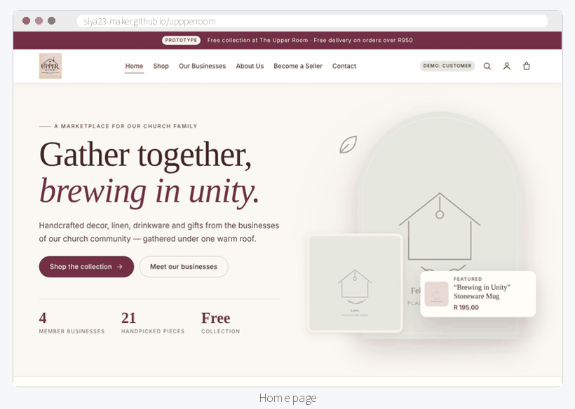
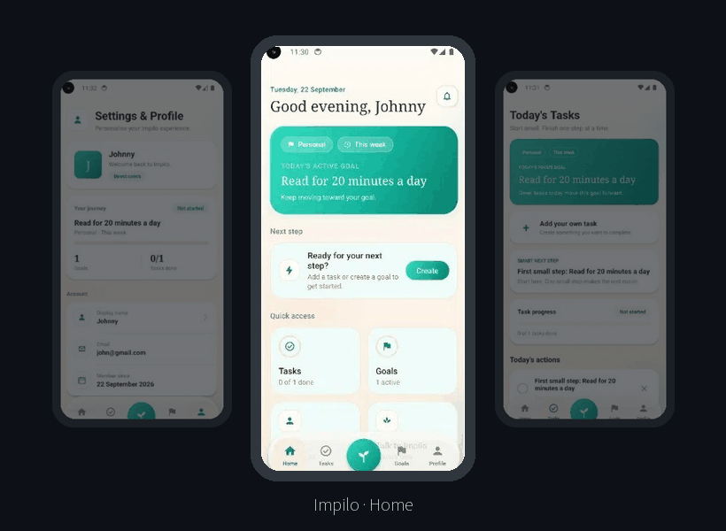

# Hi, I'm Siyamthanda Mgqoboka

**Junior Software Developer · Full-Stack & Mobile** · Gqeberha, South Africa

I build websites and mobile apps from start to finish: the database, the API behind the app, and the screens people use. I'm a final-year Computer Science and Application Development student at Emeris, with a Higher Certificate (with distinction) in Mobile Application and Web Development. I'm available immediately for remote or on-site roles.

**Portfolio:** [siya23-maker.github.io/portfolio](https://siya23-maker.github.io/portfolio/) · **Email:** [siyamthandamgqoboka185@gmail.com](mailto:siyamthandamgqoboka185@gmail.com)

**Languages:** C#, JavaScript, TypeScript, Dart, Kotlin, HTML, CSS
**Back end:** ASP.NET Core, Entity Framework Core, Node.js, Express, REST APIs
**Front end & mobile:** Flutter, Android, React, Vite
**Databases:** Firebase, MongoDB, SQLite
**Testing & DevOps:** xUnit, Jest, Vitest, Postman, Git, GitHub Actions, Docker, Railway, AWS, Azure

---

## Projects

### The Upper Room: church community marketplace
*Client website, live · Sole developer*

A marketplace website I designed and built for a church client, where church members sell their handmade products. It has a shop with search and filters, a three-step seller application, and dashboards for customers, sellers and admins.

**Built with:** HTML, CSS, JavaScript, Node.js, GitHub Pages
**[View the live website](https://siya23-maker.github.io/uppperroom/)** · **[View the code](https://github.com/Siya23-maker/uppperroom)**

---

### HustleHub+: secure freelancer marketplace
*Team project · Full-stack developer (database and back end)*

A website where freelancers advertise gigs and clients book and pay them. I set up the MongoDB database and built the back-end layers. Security is built into every layer: secure logins with JWT and bcrypt, user roles, rate limiting and Helmet security headers. Every test passes.

**Built with:** MongoDB, Express, React, Node.js, Jest, Vitest, Postman
*The code is in a private university repository. I can show it on request.*

---

### Impilo: mental health companion app
*Team project · API developer*

An Android app that helps people set small goals, break them into daily tasks and talk to a supportive AI companion. I designed and built the API the app runs on, connected the app to it, and hosted it on Railway with automatic builds through GitHub Actions.

**Built with:** Android, Kotlin, REST API, Railway, GitHub Actions
*The code is in a private university repository. I can show it on request.*

---

### Smart-X Detecto: real-time sensor management
*Full-stack developer*

A system that receives sensor readings, decides which ones are urgent, saves them and responds in real time. An ASP.NET Core back end drives an animated fish-tank simulation built in Flutter with the Flame game engine. Both parts have automated tests.

**Built with:** C#, ASP.NET Core, Entity Framework Core, SQLite, Flutter, Flame, xUnit
*The code is in a private university repository. I can show it on request.*

---

###  Reggy: smart student registration app
*Team project · Lead developer*

A Flutter app that takes Emeris students from applicant to registered: progress tracking, document uploads, a scannable QR-code student ID, campus navigation and an AI assistant. I led the development team and built across the front end and back end.

**Built with:** Flutter, Dart, Material Design
**[View the code](https://github.com/Siya23-maker/reggy_app)**

---

### More projects
- **[Stacey](https://github.com/Siya23-maker/stacey-wellness-assistant):** a conversational wellness companion connected to Impilo.
- **Savora:** a budgeting app to plan a budget, track spending and see where money goes.
- **Church Bible app:** a shared reading-plan app built for my church.
- **[Portfolio](https://github.com/Siya23-maker/portfolio):** my portfolio website, built with React and TypeScript.
