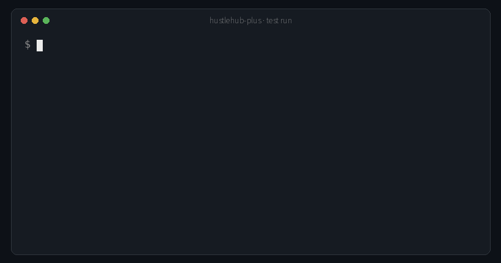
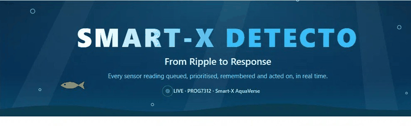

  

  
  
  

  

I build websites and mobile apps from start to finish: the **database**, the **API** behind the app, and the **screens** people use. I'm a final-year Computer Science and Application Development student at **Emeris**, with a Higher Certificate **(with distinction)** in Mobile Application and Web Development. I've led a development team, owned a production API and launched a live website for a real client.

## 🛠️ Tech stack

   
   
  

## 🚀 Featured projects

### 🛍️ The Upper Room: church community marketplace
**Client website, live** · Sole developer, design and build

A marketplace website I designed and built for a church, where member businesses sell their products. It has a shop with search and filters, a three-step seller application, and separate dashboards for customers, sellers and admins.

  
  
  
  
  
    
  
  

### 🔐 HustleHub+: secure freelancer marketplace
**Team project** · Full-stack developer, database and back end

A website where freelancers advertise gigs and clients book and pay them. I set up the MongoDB database and built the back-end layers. Watch a request travel through the security layers, and a brute-force login attempt get blocked:

  
  
  
  
  
  
  
  
   🔒 The code is in a private university repository. I can show it on request.

### 💚 Impilo: mental health companion app
**Team project** · API developer

An Android app that helps people set small goals, break them into daily tasks and talk to a supportive AI companion. *Impilo* is isiXhosa for "life" and "health". I designed and built the API the app runs on, connected the app to it, and hosted it on Railway with automatic builds through GitHub Actions.

  
  
  
  
  
   🔒 The code is in a private university repository. I can show it on request.

### 🐟 Smart-X Detecto: real-time sensor management
**Full-stack developer**

A system that receives sensor readings, decides which ones are urgent, saves them and responds in real time. An ASP.NET Core back end drives *AquaVerse*, an animated underwater world built in Flutter with the Flame game engine.

  
  
  
  
  
  
  
   🔒 The code is in a private university repository. I can show it on request.

### 🎓 Reggy: smart student registration
**Team project** · Lead developer

A Flutter app that takes Emeris students from applicant to registered in one place. I led the development team, split the work, and built across the front end and back end.

  
  
  
    
  

## 🧩 More projects

<table>
  <tr>
    <td width="33%" valign="top">
      <b>🤖 <a href="https://github.com/Siya23-maker/stacey-wellness-assistant">Stacey</a></b> 
      A conversational wellness companion connected to Impilo.
    </td>
    <td width="33%" valign="top">
      <b>💰 Savora</b> 
      A budgeting app to plan a budget, track spending and see where money goes.
    </td>
    <td width="33%" valign="top">
      <b>📖 Church Bible app</b> 
      A shared reading-plan app built for my church, so members read together.
    </td>
  </tr>
</table>

## 📈 Activity

  <picture>
    <source media="(prefers-color-scheme: dark)" srcset="https://raw.githubusercontent.com/Siya23-maker/Siya23-maker/output/github-snake-dark.svg">
    
  </picture>

## 🏊 Beyond code

**Ironman finisher.** I trained for and completed a full Ironman triathlon. The same discipline, planning and stamina go into my work. I also train at the gym and read widely.

  <a href="https://siya23-maker.github.io/portfolio/"><b>See everything on my portfolio →</b></a>

